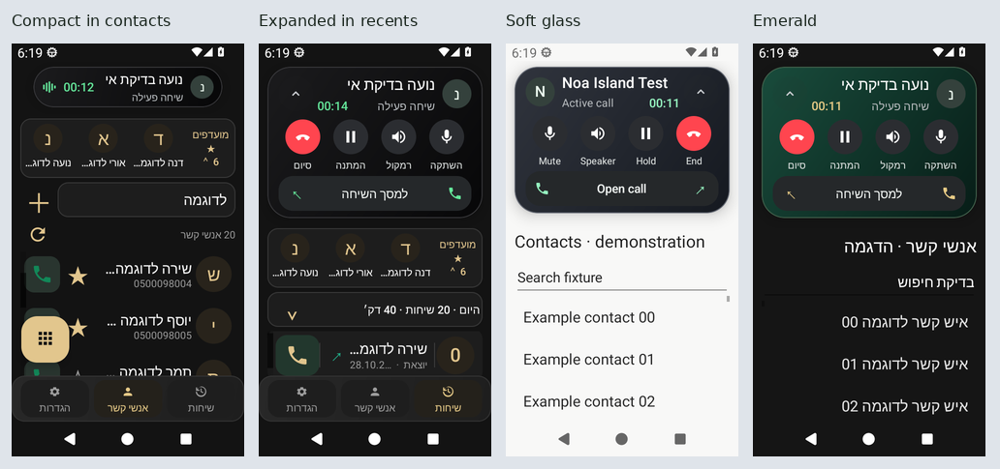

# DA CALLER — אי דינמי לשיחות

גרסת בדיקה **0.11.0-beta.8**, קוד **18**. [PR #5](https://github.com/hadar1233hr-afk/D.A.-Caller/pull/5), מעל PR #4.

האי מוצג בראש מסכי האפליקציה בזמן שיחה. הקשה מרחיבה לפקדים, לחיצה ממושכת פותחת את מסך השיחה, וחץ הצמצום מחזיר לקפסולה. בשיחה נכנסת זמינים מענה ודחייה; בשיחה יוצאת/פעילה זמינים ניתוק, השתקה, רמקול והמתנה/המשך לפי היכולות והמצב שהמערכת מספקת. אישור לפני סיום או דחייה מופעל כברירת מחדל. פקדים ישנים אינם יכולים לפעול על שיחה שהחליפה את השיחה המקורית.

**הגדרות ← שיחות ומענה ← אי שיחה דינמי**: שחור קלאסי/זכוכית רכה/אמרלד, קומפקטי/מרווח, הפעלה/כיבוי, טיימר, תמונה, אנימציה, בחירת שלושה פקדים ואישור לפני סיום. כל עשר ההעדפות נכללות בגיבוי. יש הדגמה אינטראקטיבית המסומנת כהדגמה ואינה מבצעת שיחה אמיתית.

האי מפנה מקום לתוכן ושומר את אותה רשימה, שאילתת חיפוש ומיקום גלילה. במסך צפוף, הרחבה מסתירה זמנית את שורת הספירה/רענון ואת כפתור החיוג הצף, ומחזירה אותם בצמצום ללא שינוי ההעדפות. הרקע סביב האי תואם למסך הבהיר/כהה. בדיקת המקום לרשימה מתייחסת למצבים שצולמו; שילובים נוספים של שם ארוך במיוחד וסיכום מורחב לא נטענים כמאומתים.

אין הרשאת אינטרנט או ציור מעל אפליקציות אחרות. חיווי התנועה דקורטיבי ואינו מקליט או מודד מיקרופון. האנימציה נעצרת ברקע ומכבדת את הגדרת האנימציה במכשיר. מצב המיקרופון והרמקול מתעדכן לפי אישור Telecom. מסלול החיוג, מסד הארכיון, מזהה החבילה והמוצרים הנפרדים לא שונו.

## אימות

מקור הצילומים והסקירה: `51f975011692c44cf348139e7d8d2569eec74d5d`, עץ האפליקציה `48d9adfcc8341e8f36413313b63d2f4e8e5f569b`. [הרצה שעברה](https://github.com/hadar1233hr-afk/D.A.-Caller/actions/runs/40642457660). [סקירה עם 219 חתימות הצילומים](evidence/island-2026-10-27/visual-review.json), [כל הצילומים המקוריים והראיות](evidence/island-2026-10-27/reviewed-Android13-219.zip). שלושה סוקרים בדקו את כל המקוריים; התיקונים וההסתייגויות מפורטים בראיות. לא נותר חסם חזותי בסקירה זו.

| בדיקה | תוצאה |
| --- | --- |
| בדיקות יחידה | 239/239 |
| מבחני Android 13 | PASS — 29/29 |
| סקירה של PNG מקוריים | PASS — 219/219 |
| Debug / AndroidTest / Release לא חתום | PASS מקומי |
| lint | 0 שגיאות; 5 אזהרות OldTargetApi/SetTextI18n |
| חבילה/גרסה/הרשאות/בידוד | com.dacaller.app, קוד18, min26/target34, ללא INTERNET או SYSTEM_ALERT_WINDOW |
| SIM, Bluetooth ו־Jelly Star פיזיים | NOT TESTED |
| חתימת עדכון התואמת להתקנה קיימת | BLOCKED — מפתח פרטי תואם אינו זמין |

מטריצת Android כוללת 219 צילומים: 101 של מסכי השיחה הקודמים, 17 וידג׳טים, 4 הגדרות, 53 התאמות קודמות, 8 התראות/חזרה לשיחה, ו־36 של האי. צילומי האי מכסים שלושה סגנונות, בהיר/כהה, עברית/אנגלית, קומפקטי/מורחב וגופן1.3; ארבעה מצבי שיחה/יכולת; ראש/תחתית ההגדרות; וארבעת המצבים קומפקטי/מורחב בתוך אנשי קשר ושיחות אחרונות אמיתיים. הרזולוציה480×854, צפיפות240dpi וסרגל ניווט Android אמיתי בעל שלושה כפתורים.

במסך הצילום בלבד מנותקים מאזיני הספק וממתינים לסיום המשימות לפני טעינת אנשי הקשר הסינתטיים. קוד הספק בפועל לא שונה. קיימת הסתייגות קלה: בצילום בהיר אחד של fixture הבדיקה בלבד, שעון המערכת נלכד בניגודיות נמוכה בזמן מעבר; הצילום המורחב וכל צילומי האפליקציה האמיתיים וההגדרות קריאים.

מצבי השיחה באמולטור סינתטיים ומזינים את הרכיב והבקר של הייצור. בדיקות היחידה בודקות בנפרד את פקודות Telecom והגנות המצב/מזהה/יכולת. אין טענה לשיחה סלולרית אמיתית באמולטור. בדיקות המכשיר, Bluetooth, קירבה, צלצול, מסך נעילה, קיצורי יצרן ובדיקת TalkBack מלאה עדיין נדרשות. במצב קומפקטי הטיימר אינו נחשף בנפרד להקראה; במצב מורחב הוא נגיש. שורש התצוגה המורחבת עשוי לחשוף פעולת לחיצה ריקה לקורא מסך; פקדי הילדים נפרדים.

## התקנה

קישור הגרסה: [v0.11.0-beta.8-debug](https://github.com/hadar1233hr-afk/D.A.-Caller/releases/tag/v0.11.0-beta.8-debug). [קישור APK ישיר](https://github.com/hadar1233hr-afk/D.A.-Caller/releases/download/v0.11.0-beta.8-debug/DA-CALLER-v0.11.0-beta.8-debug.apk). תהליך הפרסום משתמש בקובץ המדויק שהותקן בבדיקות האמולטור, ללא בנייה נפרדת. החתימה, SHA-256 והצילומים של הרצת הפרסום מצורפים לאותה גרסה. סטטוס הפרסום והאימות הציבורי מתעדכנים ב־PR #5.

זהו APK בדיקה בחתימת DEBUG זמנית. עדכון השומר נתונים מחייב חתימה תואמת; אין הבטחה להתאמה לגרסאות קודמות. **אין להסיר התקנה קיימת כדי להתקין את הבדיקה: הסרה מוחקת ארכיון והגדרות פרטיים. גיבוי ההגדרות אינו גיבוי לארכיון השיחות.** יש לבדוק במכשיר נוסף עד להסדרת מפתח העדכון ובדיקות החומרה.
