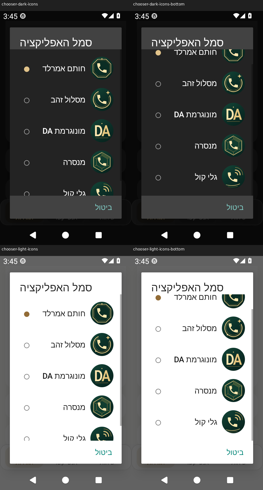
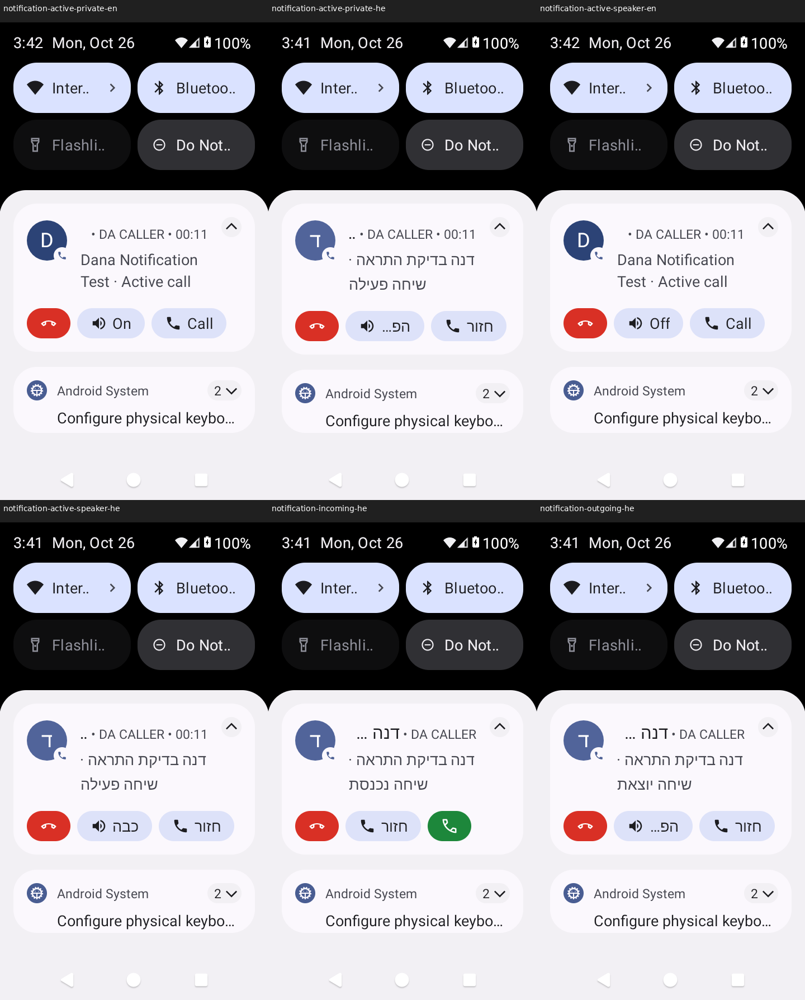

# DA CALLER — שיפורי התאמה אישית אחרי beta.6

המקור הסמכותי לשינוי הוא שש בקשות ההמשך של בעל המאגר ושתי בקשות ההמשך בנוגע להתראות ולחזרה משיחה, שנמסרו בהמשך העבודה. השינוי נבנה מעל #3 ושומר את תיקוני החיוג ואת חמשת מסכי השיחה. מוצרי `businessbook` ו־`offline` אינם חלק מהשינוי. הגרסה היא **0.11.0-beta.7**, קוד גרסה **17**.

## מה מומש

| בקשה | התנהגות |
|---|---|
| גיבוי הגדרות | הגדרות ← ארכיון אישי ← גיבוי הגדרות לקובץ. בוחרים מיקום באמצעות מנהל הקבצים של Android ונוצר JSON מקומי. שחזור מאותו אזור מציג ספירת הגדרות, מועדפים והערות ואת מדיניות הארכיון, ומחייב אישור לפני החלה. |
| חמישה סמלים | הגדרות ← מראה ← סמל האפליקציה. חותם אמרלד, מסלול זהב, מונוגרמת DA, מנסרה וגלי קול; איורים מקוריים בירוק כהה וזהב, Adaptive עם Monochrome ל־Android 13. הבחירה משנה את רכיב ה־Launcher בפועל. |
| מועדפים | לשונית המועדפים התחתונה הוחלפה ברצועה מעל אנשי הקשר ומעל השיחות האחרונות. פתוחה היא 82dp ומאפשרת גלילה אופקית לכל המועדפים; מקופלת היא 48dp. הקשה מחייגת באמצעות המסלול הקיים ולחיצה ארוכה פותחת כרטיס איש קשר. |
| סיכום שיחות | ברירת המחדל היא שורה של 48dp, עם תקופה, מספר שיחות וזמן דיבור. לחצן ייעודי מרחיב גם לשיחות נכנסות, יוצאות, שלא נענו ומשך ממוצע, במבנה קטן מהכרטיס הקודם. הקשה על התקופה מחליפה יום/שבוע/חודש/שנה. |
| צורות תמונה | ברירת המחדל היא עיגול. אפשר לבחור גם ריבוע מעוגל, ריבוע ומשושה. אותו מסלול חיתוך משמש תמונות ואותיות ברשימות, במועדפים, במסך השיחה, בפרטי איש קשר, בעורך, בארכיון ובווידג׳טים. |
| אנשי קשר בארכיון | שמות ותמונות נפתרים מול אנשי הקשר הנוכחיים במכשיר; המספר נשאר בשורה משנית. אפשר לחפש בשם ובמספר ולפתוח כרטיס איש קשר. השמות אינם מועתקים למסד הארכיון. |
| התראות שיחה | התראה מקורית לשיחה נכנסת, יוצאת ופעילה, עם שם איש הקשר, פתיחת מסך השיחה, ניתוק והפעלה/כיבוי של רמקול. פעולות נקשרות לשיחה המסוימת ומסתמכות על נתוני Telecom. |
| חזרה משיחה | מקש חזור חוזר לאפליקציה ולמסך האחרון, כולל מצב רשימות וחיפוש, בלי לנתק ובלי לחייג שוב. |

## שמירת נתונים ופעולה ללא אינטרנט

- לא שונו `CallLauncher`, סכמת הארכיון, מזהה החבילה או מפתחות העדפות קיימים. אין הרשאת `INTERNET`.
- הגיבוי כולל את העדפות האפליקציה, המועדפים והערות השיחה המקומיות. הוא עשוי לכלול מספרי טלפון. הוא **אינו גיבוי של אנשי הקשר, תמונותיהם, יומן השיחות או ארכיון השיחות**; נתונים אלה אינם נמחקים בשחזור.
- הרשאות Android ותפקיד חייגן ברירת המחדל נקבעים במערכת ואינם משוחזרים מקובץ. מיקומי ווידג׳טים ומזהי המופעים שלהם שייכים ל־Launcher, אינם ניידים, ומיפויי הווידג׳טים הקיימים נשמרים.
- הקובץ מאומת לפני שינוי: זהות מוצר ופורמט, גרסה, UTF־8 תקין, שדות מוכרים בלבד, טיפוסים וערכים מותרים, מניעת מפתחות כפולים וגודל מרבי 2MiB. ביטול או קובץ פגום אינם מחילים הגדרות. שינוי תקופת הארכיון מוצג באישור; הוא משפיע על עדכוני ארכיון עתידיים, ללא מחיקה מיידית במסך השחזור.
- ב־Android 13 החלפת סמלים נעשית בעדכון רכיבים אטומי; בגרסאות קודמות הרכיב החדש מופעל לפני השבתת הקודמים. `MainActivity` ורישום החיוג שלה נשארים פעילים. Launcher של יצרן עשוי לשמור תמונה במטמון לזמן מה.
- רשימת המועדפים מייצרת רק את התאים הסמוכים לאזור הנראה. אלף מועדפים אינם גורמים לאלף תמונות ותצוגות פעילות.
- זיהוי ארכיון נעשה ברקע דרך אינדקס `PhoneLookup`, לכל מספר ייחודי, כולל מספרים משניים. אין ניחוש לפי סיומת, ושמות מוסרים מהתצוגה לאחר שלילת הרשאת אנשי קשר. מספר חסוי/לא זמין אינו מזוהה בטעות ואינו מקבל פעולת חיוג.

## אימות

| תחום | תוצאה וראיה |
|---|---|
| גיבוי ושחזור | PASS — קובץ אמיתי דרך SAF, בדיקת פורמט, אישור/ביטול ושחזור; הארכיון נשמר. אין גיבוי לארכיון עצמו. |
| סמלים | PASS — כל חמשת רכיבי ה־Launcher נבחרים בפועל ונשמר רישום DIAL. החלון נבדק בראשו ובתחתיתו בשני המצבים. |
| מועדפים וסיכום | PASS — גלילה עד כל המועדפים, אנשי קשר עם מספר משותף, קיפול והרחבה, עברית/אנגלית וגופן 1.3. |
| צורות תמונה | PASS — ארבע צורות באותו מסלול חיתוך לתמונות ולאותיות, כולל ווידג׳טים. |
| ארכיון | PASS — אנשי קשר זמניים אמיתיים בספק Android, שם/מספר/תמונה וחיפוש; ניגודיות סמלי המערכת נבדקת בפיקסלים של הצילום עצמו. |
| התראות | PASS באמולטור — SystemUI אמיתי מציג נכנסת/יוצאת/פעילה; לחצני רמקול פועל/כבוי, חזרה וניתוק נלחצו ואושרו. מצב השיחה סינתטי; פקודות Telecom נבדקות בנפרד ביחידה. |
| חזור | PASS באמולטור — מקש המערכת מכל ארבעת הפאנלים שומר חיפוש, מזהה שורה/היסט ומסך הגדרות/גלילה. תרחישי שחזור ניווט קרים נבדקו ביחידה. |
| רגרסיות | PASS — 210/210 יחידה ו־26/26 Android; מטריצת 183 PNG בפועל כוללת את חמשת מסכי השיחה, שני המצבים, הפאנלים, גופנים, ווידג׳טים והגדרות. |
| build ו־lint | PASS — Debug, AndroidTest ו־Release לא חתום; lint ללא שגיאות ועם אזהרת OldTargetApi אחת. Release לא חתום הוא ראיית בנייה בלבד ואינו APK מופץ. |
| חתימת עדכון תואמת | BLOCKED — מפתח ההתקנה הקיימת אינו זמין; אין הבטחה לעדכון השומר נתונים באמצעות APK זה. |
| טלפוניה ומכשיר פיזי | NOT TESTED — SIM, שיחה סלולרית, צלצול, מסך נעילה, חיישן קרבה, Bluetooth, TalkBack מלא ו־Unihertz Jelly Star בפועל. |

הסביבה: Android 13 / API 33, אמולטור 480×854 בצפיפות 240dpi, ניווט מערכת מקורי בשלושה כפתורים. אין טענה שהאמולטור מחליף מכשיר פיזי. שם ארוך עשוי להתקצר בכותרת המקורית של Android; שם איש הקשר מופיע גם בתחילת גוף ההתראה לצד מצב השיחה. כפתורי הפעולה קצרים כדי להתאים למסך קטן, עם תיאור קולי מלא במטא־נתונים. בגופן 1.3 הכיתוב „הפעל” בכפתור הרמקול מתקצר בתבנית ההתראה של Android; הסמל והיעד נשארים גלויים, והתיאור הקולי המלא נשמר. תווית „שיחה חדשה” בעיצוב emerald מתקצרת בחלק ממצבי גופן 1.3, והכפתור נשאר גלוי ונגיש.

נסקרו 183 קובצי PNG אמיתיים: 122 בדיקות התצוגה הקודמות, 53 צילומים לשיפורי ההתאמה האישית ו־8 להתראות SystemUI ולחזרה משיחה. התוספת מכסה עברית/אנגלית, בהיר/כהה, גופן 1.0/1.3, מועדפים וסיכום פתוחים/סגורים, ראש ותחתית חלונות הבחירה, ארבע צורות בתמונות ובווידג׳טים, ארכיון עם איש קשר ותמונה אמיתיים מספק אנשי הקשר באמולטור, וגיבוי/אישור שחזור.

בדיקות הגיבוי משתמשות ב־Intents אמיתיים של SAF ובקריאת/כתיבת קובץ דרך ספק בדיקות. תוצאת מנהל הקבצים מסופקת על ידי Instrumentation; אין בכך אימות ידני לכל יישום מנהל קבצים. ספק הבדיקות נמצא ב־APK הבדיקות בלבד.

התראות האמולטור משתמשות ב־`CallNotifications` של הייצור ומוצגות ב־SystemUI המקורי. מקלט DEBUG בלבד מאשר פעולות בשיחה סינתטית; הוא אינו מבצע שיחות סלולריות. Android 13 דורש שהתראת CallStyle שקטה תישלח משירות foreground אמיתי. הרצת ביניים חשפה את הדחייה הזו; שירות השיחות משתמש כעת במחזור חיים `phoneCall` עד סיום השיחה האחרונה, וה־fixture באמולטור משתמש באותו כלל. הרשאות השירות הקדמי הן FOREGROUND_SERVICE ו־FOREGROUND_SERVICE_PHONE_CALL; תפקיד חייגן ברירת המחדל הוא חלופת ההרשאה המתועדת ל־MANAGE_OWN_CALLS. החרגת lint נקודתית בשירות מתעדת את חלופת התפקיד, שהבודק בגרסה זו אינו מזהה.

בדיקות יחידה מפעילות את PendingIntent האמיתי של שירות השיחות ומוודאות קריאות Telecom, ניתוק והחלפת נתיב קול לפי מצב מאומת. בדיקת Back באמולטור משתמשת במקשי מערכת ובאנשי קשר זמניים אמיתיים בספק Android.

## מגבלות התקנה ומכשיר

גרסת DEBUG אינה מבטיחה אפשרות עדכון להתקנה בעלת חתימה אחרת. **אין להסיר התקנה קיימת כדי להתקין APK בדיקה: הסרה מוחקת את הארכיון וההגדרות הפרטיים.** גם קובץ גיבוי ההגדרות החדש אינו גיבוי לארכיון השיחות. עדכון השומר את נתוני ההתקנה הקיימת מחייב מפתח חתימה תואם.

ללא מכשיר פיזי לא מאומתים: שיחות סלולריות ו־SIM, צלצול/נעילה/קרבה, Bluetooth אמיתי, Launcher של Jelly Star, נגישות TalkBack מלאה ומעבר גרסה עם חתימת ההתקנה הקיימת. אין טענת בדיקה פיזית או גרסת ייצור.

## צילומים מתוך ההרצה שנבדקה

[מועדפים וסיכום](evidence/personalization-2026-10-25/previews/favorites-summary-native.png) · [ארכיון](evidence/personalization-2026-10-25/previews/archive-native.png) · [צורות תמונה](evidence/personalization-2026-10-25/previews/avatar-shapes-native.png)

## הורדה וראיות

- [גרסת הבדיקה ו־APK](https://github.com/hadar1233hr-afk/D.A.-Caller/releases/tag/v0.11.0-beta.7-debug) — החבילה היא הקובץ המדויק שהותקן במשימת האמולטור, ללא בנייה מחדש בשלב הפרסום.
- [APK ישיר](https://github.com/hadar1233hr-afk/D.A.-Caller/releases/download/v0.11.0-beta.7-debug/DA-CALLER-v0.11.0-beta.7-debug.apk), [SHA256](https://github.com/hadar1233hr-afk/D.A.-Caller/releases/download/v0.11.0-beta.7-debug/DA-CALLER-v0.11.0-beta.7-debug.apk.sha256) ו־[כל צילומי האמולטור](https://github.com/hadar1233hr-afk/D.A.-Caller/releases/download/v0.11.0-beta.7-debug/DA-CALLER-v0.11.0-beta.7-Android13-screenshots.zip).
- [Pull Request #4](https://github.com/hadar1233hr-afk/D.A.-Caller/pull/4), מעל #3; נשאר טיוטה בשל מגבלות המכשיר והחתימה.
- מקור הסקירה: `849c0975bf967e94fd584cb64b74c2eb86cf098e`; עץ האפליקציה: `45541f829fb6d7af4aa1aff8a41d8e562b822006`; [הרצת האמולטור שנסקרה](https://github.com/hadar1233hr-afk/D.A.-Caller/actions/runs/40350904837).
- [מניפסט סקירה עם 183 חתימות קבצים](evidence/personalization-2026-10-25/visual-review.json), [יחידה](evidence/personalization-2026-10-25/local-unit-tests.json), [lint](evidence/personalization-2026-10-25/local-lint.json) ו־[אימות חבילות מקומי](evidence/personalization-2026-10-25/local-apk-verification.json).

הרצות הביניים נרשמו ככישלון כשנמצאו ציפיית תרגום שגויה, ניגודיות סמלי מערכת חסרה, דרישת foreground של Android, בעיית איתור בעץ הנגישות ושם מתקשר שנעלם בכותרת הקטנה. התיקונים אומתו בצילומים חדשים לפני אישור הסקירה. פרסום מאושר רק אם עץ `app` זהה לעץ שנסקר וכל בדיקות ההרצה החדשה עברו.

[הצילומים המדויקים שנסקרו — ZIP קבוע במאגר](evidence/personalization-2026-10-25/reviewed-Android13-183.zip). קובץ הצילומים שב־Release מופק בהרצת הפרסום הנוספת מאותו עץ אפליקציה, ועשוי לכלול שעת מערכת שונה.
