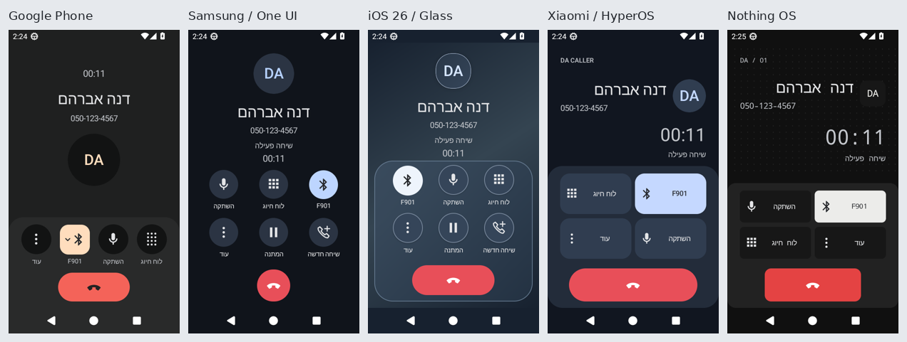
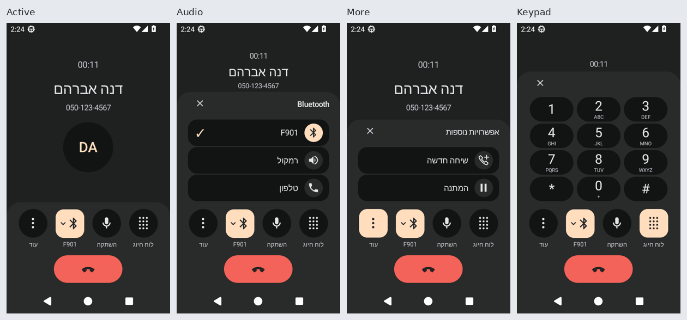

# DA CALLER — דוח אימות 0.11.0-beta.6

הפיתוח בוצע מעל `cff9ac4` ‏(0.11.0-beta.5), בענף נפרד וב־[PR #3](https://github.com/hadar1233hr-afk/D.A.-Caller/pull/3) מעל הענף של #2. מקור האפליקציה שנסקר: `67ddfc6bb90f11a10fb3ef0b93392a67013d389e`; עץ `app` המדויק: `0444d22c08abc22969fff129b8f2d707afcb63ed`. הפרסום מוודא שעץ זה לא השתנה אחרי הסקירה.

גרסת בדיקה **0.11.0-beta.6**, ‏versionCode **16**, חבילה `com.dacaller.app`, ‏minSdk26 ו־targetSdk34. **אין כאן אישור מוכנות להפצה בחתימה קבועה או הוכחה לפעילות סלולרית במכשיר פיזי.**

[הורדת APK בדיקה ומסמכי חתימה/מטא־נתונים](https://github.com/hadar1233hr-afk/D.A.-Caller/releases/tag/v0.11.0-beta.6-debug) · [ZIP צילומי Android13](https://github.com/hadar1233hr-afk/D.A.-Caller/releases/download/v0.11.0-beta.6-debug/DA-CALLER-v0.11.0-beta.6-Android13-screenshots.zip) · [הרצת המקור שנסקר](https://github.com/hadar1233hr-afk/D.A.-Caller/actions/runs/40201648675).

## מה השתנה

| תחום | מימוש ואימות | מצב |
|---|---|---|
| Google Phone | ברירת מחדל כשאין בחירה שמורה; טיימר, שם, מספר ותמונה; מגש ארבע פעולות בסדר הפיזי עוד/שמע/השתקה/לוח חיוג; אפרסק לבחירה ואלמוג לניתוק. מצבים בסיסי, שמע, עוד ו־DTMF בהיר/כהה. | PASS חזותי |
| ארבעת העיצובים האחרים | One UI עם פרופיל עגול ומערך 3×2; iOS26 עם שכבות זכוכית יעילות וכפתור ניתוק רחב; HyperOS עם פרופיל אופקי וכרטיסי פעולות; Nothing עם טיפוגרפיה טכנית, נקודות ומבנה רצועות. ניתן להבחין ביניהם גם בגווני אפור. מזהי העדפות קיימים נשמרו. | PASS חזותי |
| ניתוק ונגישות | שפופרת ניתוק וקטורית בלבד בכל העיצובים וגם במסך החירום; תווית TalkBack נשמרה. מקשים בגובה 48dp לפחות ופקדים גלויים מעל ניווט המערכת. | PASS אוטומטי וחזותי |
| שמע ויכולות שיחה | Telecom הוא מקור המצב. אין Bluetooth מזויף בשיחה אמיתית; השם מגיע מההתקן כשמותר. בחירה קשורה להתקן שהוצג ונבדקת שוב אחרי שינוי רשימת התקנים. יכולות המתנה/שיחה חדשה מתעדכנות גם בלי שינוי מצב שיחה; פקד ישן אינו שולח פעולה לאחר ביטול יכולת. | PASS בסימולציה; חומרה לא נבדקה |
| DTMF ומגשים | מגש יחיד בכל רגע; מקשים עם אותיות ו־+; צליל מוגבל בזמן ונעצר בסגירה, השהיה, שינוי מצב או החלפת שיחה. פעולות לא נתמכות מושבתות עם הסבר. | PASS יחידה ואמולטור |
| ווידג׳טים | קיצור חיוג קומפקטי 1×1; כרטיס איש קשר 2×1 עם מספר; ארבעה מועדפים בפריסה צרה וחמישה ברחבה. תמונות/ראשי תיבות, RTL, בהיר/כהה, הרשאות וריק, שינוי גודל והחלפת יעד. PendingIntent ייחודי לפי משבצת ואיש קשר; מחיקת ווידג׳ט אינה מוחקת מועדפים. | PASS, מארח Android אמיתי ו־17 צילומים |
| חזרה מאיש קשר | שמירת מזהה איש קשר והיסט, חיפוש ועוגן אחרי טעינה; מניעת שמירת מיקום זמני בין שני רענונים וביטול שחזור ישן אחרי גלילה. בקוד הישן בדיקת הרגרסיה החזירה ID1 במקום ID47; בקוד המתוקן היא עוברת. | PASS, שש בדיקות יחידה וארבע בדיקות אמולטור |
| הגדרות | הסרת סמל הטלפון רק מכותרת שיחות ומענה; הרשאות וחיבור למערכת עם מצבי תפקיד חייגן/שיחות/אנשי קשר/יומן/התראות והרשאת שם Bluetooth אופציונלית. פעולות אישור/ניהול ורענון בחזרה מהמערכת, אבחון מקומי ללא מספרים, פתיחה וסגירה חוזרות. | PASS, חמש בדיקות יחידה ובדיקת אמולטור בשני המצבים |
| הנפשות | כניסה קצרה של 180ms לפי שפה עיצובית, Fade של 170ms בהגדרות ו־Ripple מקורי בלחיצה. ביטול הנפשות מערכת מכובד; אין טשטוש כבד. סגירת מגש מיידית לשמירת מעבר מצב ברור ופקדים זמינים. | מימוש נבדק; זמני פריימים במכשיר לא נמדדו |
| חיוג, נתונים ו־Offline | מסלול CallLauncher לא שוכתב; בדיקות החיוג מרשימות נשמרו. אין שינוי בסכמת הארכיון, מחיקת נתונים, איפוס העדפות או מזהה חבילה. אין הרשאת INTERNET. המודולים האחרים לא שונו ולא נכללים ב־APK. | PASS במסגרת הבדיקות; רציפות עדכון חתימה חסומה |

## תוצאות בפועל

- **136/136 בדיקות JUnit/Robolectric עברו**, ללא כישלון, שגיאה או דילוג. אלו בדיקות JVM של Android, לא מכשיר או רשת סלולרית.
- **17/17 בדיקות אמולטור Android13 עברו**, ללא כישלון, שגיאה או דילוג. הן משתמשות בנתונים פיקטיביים בלבד ואינן מבצעות שיחות סלולריות.
- **122 קובצי PNG אמיתיים אומתו ונסקרו**: 80 מסכי שיחה (5×2×4×גופן רגיל/1.3), עשרים שמות ארוכים בעברית/אנגלית, אנגלית ללא Bluetooth, שבעה־עשר ווידג׳טים וארבע הגדרות.
- רזולוציה **480×854**, צפיפות **240dpi**, פס מצב **36px** ופס ניווט Android מקורי של שלושה כפתורים **72px**. האזור הזמין לאפליקציה כ־497dp בגובה; פקדי הניתוק נשארו גלויים.
- `assembleDebug`, ‏`assembleDebugAndroidTest`, ‏`testDebugUnitTest` ו־`lintDebug` עברו. **Lint: אפס שגיאות ואזהרת OldTargetApi אחת**, עקב השארת targetSdk34. לא הועלתה דרישת minSdk.
- נבדקו זהות החבילה, גרסה, minSdk, חתימה תקפה והפרדת המודולים. קובצי SHA-256, חתימה ומטא־נתונים מצורפים ל־Release. החתימה היא DEBUG.

[פירוט בדיקות יחידה](evidence/2026-10-25/local-unit-tests.json) · [Lint](evidence/2026-10-25/local-lint.json) · [תוצאות CI](evidence/2026-10-25/remote-ci.json) · [מפת 122 התמונות](evidence/2026-10-25/visual-matrix.json) · [הסקירה והגיבובים של כל תמונה](evidence/2026-10-25/visual-review.json).

## כשלים שנמצאו ותוקנו תוך כדי האימות

הסבב הראשון עבר 14 בדיקות אך סקירת התמונות גילתה אותיות ותוויות חתוכות בגופן מוגדל, חצאי פרטי שיחה מאחורי מגשים, יישור עברית שגוי וסימון שמע בהיר מדי. גם פקודת צילום ההגדרות/ווידג׳טים יצרה תיקיות בשם PNG ולא תמונות. כל אלה תוקנו; [הסקירה הראשונה](evidence/2026-10-25/first-visual-review.json) נשמרה.

בסבב השני נכשלו שש מתוך 17 בדיקות מחמירות: מרווח שורת טקסט קטן מדי, חפיפה ממשית של פיקסל בפרטי המתקשר וכותרת ווידג׳ט צפופה. בדיקת ההגדרות הסתיימה לפני שגלילת OverScroller הסתיימה; היא ממתינה כעת לתחתית ולתצוגה מלאה של האבחון. הדרישות לא רוככו. [הכשל השני](evidence/2026-10-25/second-visual-review.json) מתועד; ההרצה השלישית עברה ונסקרה.

## התאמות ומגבלות

המפרט שהתקבל נשמר ללא שינוי ב־[מסמך המקור](DA_CALLER_VISUAL_SPEC_HE.md). הועלה Markdown ולא ZIP; ארבע התמונות היו גלויות בשיחה, אך קובצי PNG מקוריים לא היו זמינים לדגימת פיקסלים. הצבעים והמבנה הותאמו חזותית; אין טענה להשוואת פיקסלים מדויקת או להעתקת משאבי Google.

כאשר מגש פתוח, כותרת מתקשר מקוצרת מונעת חפיפה במסך קטן. במקשים מוצג הטיימר ללא בלוק השם הגדול. שמות ארוכים ומיתוג כותרת ווידג׳ט צר מקוצרים אופקית בשלוש נקודות; שם איש הקשר המלא נשאר במודל ובתיאור הנגיש. בסביבת האמולטור נעשה שימוש בראשי תיבות ובנתונים פיקטיביים, ללא מידע אישי.

**לא נבדקו פיזית:** חיוג נכנס/יוצא דרך SIM, צלצול, מענה במסך נעילה, קרבה, מעבר בין אפרכסת/רמקול/אוזנייה אמיתית, כמה שיחות עם מפעיל סלולרי, TalkBack מלא, Launcher של Jelly Star, תמונות אנשי קשר אמיתיות ורציפות עדכון ההתקנה הקיימת. אין טענה למדידת מהירות או חלקות על Jelly Star.

**חתימה ונתונים:** APK זה הוא גרסת בדיקה בחתימת DEBUG, שאינה מבטיחה עדכון להתקנה בעלת תעודה אחרת, לרבות גרסאות 0.11 beta קודמות. **אין להסיר את הגרסה הקיימת לצורך התקנתו: הסרה מוחקת את הארכיון וההגדרות הפרטיים.** נדרש מפתח החתימה התואם להתקנה הקיימת לפני הבטחת עדכון ללא אובדן נתונים. מסלול פרסום בחתימה קבועה נשאר נפרד ומותנה בבדיקות המכשיר ובמפתח מאובטח; [מדיניות הפרסום](evidence/2026-10-25/release-policy.json).

[מיפוי כל 52 פסקאות/שורות התוכן במפרט](evidence/2026-10-25/spec-traceability.json) מפרט PASS/BLOCKED/NOT TESTED והיקף הראיות לכל דרישה. אין כאן טענה גורפת שכל דרישה הוכחה על חומרה אמיתית.
